# PocketBridge — Master Phases Roadmap to Version 1.0 (v1.0.0)

This document defines the complete development roadmap for **PocketBridge** from initial inception through the **Version 1.0 (v1.0.0) Production Release**. Every phase defines a strict architectural milestone with technical objectives, subsystem mapping, detailed implementation steps, wire protocol envelopes, and empirical exit criteria.

---

## 🗺️ Master Phase Matrix to Version 1.0

```mermaid
flowchart LR
    P0["Phase 0: Feasibility\n(v0.1.0)"] --> P1["Phase 1: Vertical Slice\n(v0.2.0)"]
    P1 --> P2["Phase 2: Job Lifecycle\n(v0.3.0)"]
    P2 --> P3["Phase 3: Explainable Scheduler\n(v0.4.0)"]
    P3 --> P4["Phase 4: Production Adapters\n(v0.5.0)"]
    P4 --> P5["Phase 5: Android Power & OS\n(v0.6.0)"]
    P5 --> P6["Phase 6: Multi-Worker Mesh\n(v0.7.0)"]
    P6 --> V1["Version 1.0 Release\n(v1.0.0)"]
    V1 -.-> R["Post-v1.0 Research\n(NDK / Vulkan)"]

    classDef done fill:#2e7d32,stroke:#1b5e20,color:#fff;
    classDef active fill:#f57f17,stroke:#e65100,color:#fff;
    classDef planned fill:#1565c0,stroke:#0d47a1,color:#fff;
    classDef release fill:#6a1b9a,stroke:#4a148c,color:#fff;

    class P0,P1,P2 done;
    class P3 active;
    class P4,P5,P6 planned;
    class V1 release;
```

| Phase | Target Version | Milestone Name | Status | Key Deliverable | Verified Environment |
| :---: | :---: | :--- | :---: | :--- | :--- |
| **0** | `v0.1.0` | **Feasibility & Link Foundation** | `COMPLETED` | USB-C ADB framing, latency ping, 100MB throughput tests, hardware profiler, Ratatui TUI | Arch Linux + Samsung Galaxy S25 Ultra (Snapdragon 8 Elite, 370 Mbps) |
| **1** | `v0.2.0` | **Vertical Slice & Deterministic Workload** | `COMPLETED` | `chunk_transform.v1` compute engine, SHA-256 equivalence validation, speedup measurement | Arch Linux + Samsung Galaxy S25 Ultra (Bit-for-bit SHA-256 verified) |
| **2** | `v0.3.0` | **Job Lifecycle & Reliability** | `COMPLETED` | Full protocol envelopes (`SUBMIT`, `ACCEPTED`, `STARTED`, `PROGRESS`, `RESULT`, `CANCEL`), $O(1)$ streaming | Arch Linux + Samsung Galaxy S25 Ultra (100MB stream verified) |
| **3** | `v0.4.0` | **Explainable Scheduler & Cost Model** | `IN PROGRESS` | Analytical cost-benefit engine, battery/thermal constraint gates, human-readable offload rationale | Planned Next |
| **4** | `v0.5.0` | **Production Task Adapters** | `PLANNED` | Image batching, FFmpeg video chunking, offline audio transcription adapters | Target: Sprint 4 |
| **5** | `v0.6.0` | **Native Android OS & Power Integration** | `PLANNED` | WakeLock manager, thermal throttling listeners, Doze handling, notification telemetry | Target: Sprint 5 |
| **6** | `v0.7.0` | **Multi-Worker Fleet & Mesh** | `PLANNED` | Multi-phone USB hub scheduling, dynamic work-stealing, unplug fault tolerance | Target: Sprint 6 |
| **v1.0** | `v1.0.0` | **Production Release & Hardening** | `PLANNED` | Full test suite, security sandboxing audit, automated CI/CD packages, benchmark report | Version 1.0 Milestone |
| **R** | `v1.x+` | **Post-v1.0 Research: NDK & Hardware Accel** | `EXPLORATORY` | Android NDK SIMD C++ kernels, Vulkan/OpenCL compute shaders, direct AOA USB streaming | Long-term R&D |

---

## 🏛️ All Phases Detailed Implementation Plans

---

### Phase 0 — Feasibility & Link Foundation
- **Target Version:** `v0.1.0`
- **Status:** `COMPLETED & VERIFIED`
- **Milestone Objective:** Establish physical link constraints, measure real USB-C ADB bandwidth and latency, and build the interactive host control plane.

#### Subsystem Mapping
- `host/pocketbridge-core/src/protocol/framing.rs` — Length-prefixed framing socket.
- `host/pocketbridge-core/src/profiler/` — Host Linux hardware inspection.
- `host/pocketbridge-core/src/runner/benchmark.rs` — Ping and throughput test harness.
- `host/pocketbridge-host/src/ui.rs` — Ratatui interactive TUI dashboard.
- `worker-android/.../service/WorkerService.kt` — Foreground TCP daemon on `127.0.0.1:9876`.

#### Detailed Implementation Steps
1. **Length-Prefixed Wire Framing:**
   - Implemented 4-byte big-endian header indicating payload length followed by JSON UTF-8 payload.
   - Built `FramedSocket` in Rust and `WorkerService` in Kotlin with zero payload tearing.
2. **Ping & Latency Benchmarking:**
   - Built bidirectional timestamp ping suite; measured **~1.8 ms median latency** over ADB USB-C tunnel.
3. **Throughput & Bandwidth Benchmarking:**
   - Evaluated 1 MB, 10 MB, and 100 MB synthetic payloads over USB-C; achieved **~28 MB/s to ~35 MB/s** sustained throughput.
4. **Hardware Profilers:**
   - Host: CPU model, core count, architecture (`x86_64`), total/available RAM (`/proc/meminfo`), kernel version.
   - Android Worker: Device model, SoC ABI (`arm64-v8a`), total/free RAM (`ActivityManager`), battery %, thermal status.
5. **Interactive Host Terminal UI (TUI):**
   - Built tabbed interface with Dashboard, Benchmark runner, and Hardware Profile views.
   - Configured live log window and automated ADB port forwarding (`adb forward tcp:9876 tcp:9876`).

#### Exit Criteria & Verification Evidence
- [x] Round-trip latency consistently $< 5 \text{ ms}$ over USB-C.
- [x] Zero payload corruption across 100 MB streaming runs.
- [x] Interactive TUI responds dynamically to connection and disconnect events.

---

### Phase 1 — Vertical Slice & Deterministic Workload
- **Target Version:** `v0.2.0`
- **Status:** `COMPLETED & VERIFIED`
- **Milestone Objective:** Run an identical, deterministic compute task on both host and worker, verify identical SHA-256 output, and measure real wall-clock speedup.

#### Subsystem Mapping
- `host/pocketbridge-core/src/adapter/chunk_transform.rs` — Rust reference compute engine.
- `worker-android/.../runtime/ChunkTransformEngine.kt` — Kotlin Android compute engine.
- `host/pocketbridge-core/src/client/` — Remote execution orchestration client.

#### Detailed Implementation Steps
1. **Deterministic Algorithm (`chunk_transform.v1`):**
   - Implemented high-intensity cryptographic transform (XOR bit-twiddling, multi-round modular arithmetic, SHA-256 hashing).
   - Ensured exact mathematical parity between Rust (x86_64) and Kotlin/JVM (ARM64).
2. **Bit-for-Bit Validation:**
   - Verified that identical random seed and byte chunk yield matching output SHA-256 digest on both platforms.
3. **End-to-End Speedup Measurement:**
   - Executed local reference benchmark on host CPU.
   - Offloaded identical workload to Android worker over ADB.
   - Computed total end-to-end wall-clock speedup:
     $$\text{Speedup} = \frac{T_{\text{local reference}}}{T_{\text{transfer in}} + T_{\text{remote compute}} + T_{\text{transfer out}}}$$
4. **Execution Interface:**
   - Exposed CLI subcommand `pocketbridge run` with configurable chunk count and intensity.
   - Added `[j]` keybinding to Ratatui TUI dashboard for immediate offloading trigger.

#### Exit Criteria & Verification Evidence
- [x] Local and remote SHA-256 output digests match bit-for-bit.
- [x] End-to-end timing accurately records data transmission overhead.

---

### Phase 2 — Job Lifecycle & Reliability
- **Target Version:** `v0.3.0`
- **Status:** `COMPLETED & VERIFIED`
- **Milestone Objective:** Manage the complete job state lifecycle, ensure $O(1)$ memory streaming, prevent hangs on cable disconnection, and provide failure recovery.

#### Subsystem Mapping
- `host/pocketbridge-core/src/protocol/models.rs` — Lifecycle envelope models.
- `host/pocketbridge-core/src/client/mod.rs` — State machine and timeout guard.
- `worker-android/.../service/WorkerService.kt` — Coroutine-based job runner and cancellation.
- `host/pocketbridge-core/tests/job_lifecycle_tests.rs` — Automated mock worker lifecycle suite.

#### Detailed Implementation Steps
1. **Protocol Envelope Lifecycle:**
   - Standardized state transitions:
     $$\text{SUBMIT\_JOB} \longrightarrow \text{JOB\_ACCEPTED} \longrightarrow \text{JOB\_STARTED} \longrightarrow \text{JOB\_PROGRESS} \longrightarrow \text{RESULT\_MANIFEST}$$
   - Added error and cancellation pathways: `CANCEL_JOB` and `JOB_FAILED`.
2. **$O(1)$ Memory Bounded Streaming:**
   - Implemented 64 KB buffer chunking on both host and worker to prevent JVM heap OutOfMemory crashes on large datasets.
3. **Timeout Guards & Disconnect Resilience:**
   - Implemented socket read/write timeouts (30s) on host client to prevent daemon lockups if USB-C cable is detached.
   - Structured error reporting detailing error origin (Host vs. Worker vs. Network).
4. **Automated Test Harness:**
   - Created in-process `MockWorker` validating handshake, ping, throughput, and compute execution.
   - 6/6 tests passing in `cargo test --workspace`.

#### Exit Criteria & Verification Evidence
- [x] Mid-flight cancellation cleanly releases worker resources without orphan tasks.
- [x] Cable disconnect or mock worker termination fails gracefully with descriptive error.
- [x] All automated workspace tests pass.

---

### Phase 3 — Explainable Scheduler & Cost Model
- **Target Version:** `v0.4.0`
- **Status:** `IN PROGRESS / NEXT UP`
- **Milestone Objective:** Build an intelligent decision engine that predicts whether offloading a task will be faster than executing locally, rejecting offloading if net speedup is unlikely or device health is constrained.

#### Subsystem Mapping
- `host/pocketbridge-core/src/scheduler/cost_model.rs` — Analytical transfer & compute cost estimator.
- `host/pocketbridge-core/src/scheduler/policy.rs` — Decision gate and constraint evaluator.
- `host/pocketbridge-core/src/scheduler/perf_cache.rs` — Historical performance profile cache (`perf_cache.json`).
- `host/pocketbridge-host/src/ui.rs` — Visual scheduler decision panel in TUI.

#### Detailed Implementation Steps
1. **Analytical Cost Estimation Formulas:**
   - Model local compute duration:
     $$T_{\text{local}} = \frac{\text{Workload Complexity } (W)}{\text{Host Compute Rate } (C_{\text{host}})}$$
   - Model remote round-trip duration including link latency and payload transfer:
     $$T_{\text{remote}} = T_{\text{latency}} + \frac{D_{\text{in}} + D_{\text{out}}}{\text{Bandwidth}_{\text{link}}} + \frac{\text{Workload Complexity } (W)}{\text{Phone Compute Rate } (C_{\text{phone}})}$$
2. **Decision Policy Margin:**
   - Enforce an offloading margin $\mu = 1.15$ (must be at least 15% faster to justify offloading energy and link contention):
     $$\text{Offload Approved if } T_{\text{remote}} < \frac{T_{\text{local}}}{\mu}$$
3. **Hardware Constraint Gates:**
   - **Battery Gate:** Automatically reject offloading if phone battery $< 20\%$ and not charging.
   - **Thermal Gate:** Automatically reject offloading if phone reports `THERMAL_STATUS_SEVERE` or battery temperature $> 44^\circ\text{C}$.
   - **Memory Headroom:** Reject offloading if required job memory $> 50\%$ of Android free RAM.
4. **Explainable Rationale Output:**
   - Every scheduling decision produces an explainable structured string:
     - *Approved:* `"Offload to phone (Est. 1.48x speedup; compute gain 320ms > transfer cost 75ms)"`
     - *Rejected (Overhead):* `"Kept local (Transfer cost 210ms exceeds estimated compute gain 90ms)"`
     - *Rejected (Thermal):* `"Kept local (Phone thermal status SEVERE; throttling protection active)"`
5. **Interactive UI & CLI Integration:**
   - Add Scheduler tab in Ratatui TUI displaying live prediction curves and recent decisions.
   - CLI flag `--dry-run` to inspect scheduling decision without running the workload.

#### Exit Criteria & Verification
- Unit tests verify cost model accuracy against benchmark history.
- Synthetic thermal and battery mock tests correctly reject offloading.
- Scheduler never submits tasks when transfer overhead dominates compute time.

---

### Phase 4 — Production Task Adapters
- **Target Version:** `v0.5.0`
- **Status:** `PLANNED`
- **Milestone Objective:** Expand beyond synthetic benchmarks by building real-world developer and creator task adapters.

#### Subsystem Mapping
- `host/pocketbridge-core/src/adapter/traits.rs` — Generic `WorkloadAdapter` trait.
- `host/pocketbridge-core/src/adapter/image_batch.rs` — Image downscale and WebP converter.
- `host/pocketbridge-core/src/adapter/video_chunk.rs` — FFmpeg video transcode chunking manager.
- `host/pocketbridge-core/src/adapter/audio_transcribe.rs` — Audio VAD splitter & transcription adapter.
- `worker-android/.../runtime/` — Corresponding Kotlin/NDK adapter engines.

#### Detailed Implementation Steps
1. **Generic Workload Adapter Trait:**
   - Define canonical lifecycle for task partitioning, local execution, remote execution, and result merging.
2. **Image Batch Processing Adapter:**
   - **Input:** Directory of high-resolution JPEG/PNG files.
   - **Processing:** Parallel downscaling, thumbnail creation, and lossy WebP compression.
   - **Android Engine:** `BitmapFactory.decodeByteArray()` and `Bitmap.compress(Bitmap.CompressFormat.WEBP_LOSSY)`.
3. **FFmpeg Video Transcoding Adapter:**
   - **Input:** Video stream (MP4, MKV).
   - **Host Partitioning:** Uses `ffprobe` to identify keyframes (I-frames); splits video into GOP-aligned 10-second segments.
   - **Android Engine:** Hardware-accelerated H.264/H.265 transcoding via Android `MediaCodec` API.
   - **Host Merging:** Lossless concatenation (`ffmpeg -f concat`).
4. **Audio / Speech Transcription Adapter:**
   - **Input:** WAV/MP3 voice recordings.
   - **Host Partitioning:** Voice Activity Detection (VAD) audio chunking.
   - **Android Engine:** Mobile Whisper engine (`whisper.tflite` or GGML via NDK).
5. **Compilation Artifact Cache Adapter:**
   - Distributed compiler object caching (compatible with `sccache` protocols).

#### Exit Criteria & Verification
- At least 2 real-world adapters implemented with end-to-end integration tests.
- Output files (converted images, stitched video) are bit-valid and playable without artifacts.
- Real-world speedup demonstrated on media batches $> 50 \text{ MB}$.

---

### Phase 5 — Native Android OS & Power Integration
- **Target Version:** `v0.6.0`
- **Status:** `PLANNED`
- **Milestone Objective:** Fortify the Android worker service against Android OS power management, deep Doze, and thermal throttling.

#### Subsystem Mapping
- `worker-android/.../service/WakeLockManager.kt` — Fine-grained partial wakelock lifecycle handler.
- `worker-android/.../service/WorkerNotification.kt` — Dynamic notification drawer channel with progress metrics.
- `worker-android/.../profiler/ThermalMonitor.kt` — Android 10+ `OnThermalStatusChangedListener`.
- `worker-android/.../receiver/PowerStateReceiver.kt` — Charger and battery broadcast receiver.

#### Detailed Implementation Steps
1. **WakeLock State Machine:**
   - Acquire `PowerManager.PARTIAL_WAKE_LOCK` strictly when `JOB_STARTED` is triggered.
   - Automatically release the WakeLock upon job completion (`RESULT_MANIFEST`), cancellation (`CANCEL_JOB`), or unexpected socket drop.
2. **Live Notification Telemetry:**
   - Persistent foreground service notification showing:
     - Real-time chunk completion progress bar.
     - Active workload adapter name and elapsed duration.
     - Device temperature and CPU usage.
3. **Deep Doze & Screen-Off Verification:**
   - Request battery optimization exemption (`ACTION_REQUEST_IGNORE_BATTERY_OPTIMIZATIONS`).
   - Run sustained 1-hour workloads with phone screen locked and verify uninterrupted execution.
4. **Thermal Throttling Protection:**
   - Register listener with `PowerManager.addThermalStatusListener()`.
   - Dynamically reduce worker concurrency (e.g. from 8 coroutine threads to 4) when `THERMAL_STATUS_MODERATE` is encountered.
   - Signal host scheduler with thermal warning event.

#### Exit Criteria & Verification
- Zero job drops during 30-minute background execution with screen off.
- Battery drain and thermal metrics accurately recorded and viewable in host TUI.
- WakeLocks cleanly released on all exit pathways with zero wakelock leaks detected by `dumpsys batterystats`.

---

### Phase 6 — Multi-Worker Fleet & Fault-Tolerant Mesh
- **Target Version:** `v0.7.0`
- **Status:** `PLANNED`
- **Milestone Objective:** Connect multiple Android phones simultaneously via USB hub or local Wi-Fi to form a distributed compute cluster.

#### Subsystem Mapping
- `host/pocketbridge-core/src/fleet/manager.rs` — Multi-device connection and ADB port manager.
- `host/pocketbridge-core/src/fleet/work_stealing.rs` — Lock-free work-stealing job queue.
- `host/pocketbridge-core/src/fleet/health.rs` — Heartbeat watchdog and failover coordinator.
- `host/pocketbridge-host/src/ui/fleet_view.rs` — Multi-device cluster dashboard in Ratatui.

#### Detailed Implementation Steps
1. **Multi-Device ADB Port Forwarding:**
   - Query `adb devices -l` to identify all attached device serials.
   - Assign dedicated local forward ports:
     - Device 1 (`serial_1`): `tcp:9876 -> tcp:9876`
     - Device 2 (`serial_2`): `tcp:9877 -> tcp:9876`
     - Device 3 (`serial_3`): `tcp:9878 -> tcp:9876`
2. **Dynamic Work-Stealing Queue:**
   - Workloads partitioned into small micro-chunks.
   - Fast devices automatically request and complete more chunks than slower devices without starvation.
3. **Failover & Hot-Unplug Resilience:**
   - Continuous 2-second heartbeat ping across all connected devices.
   - If a cable is unplugged mid-computation, the watchdog immediately cancels that device's connection, returns its in-flight chunks to the master queue, and re-dispatches them to healthy workers without failing the overall job.
4. **Multi-Device Cluster View in TUI:**
   - Real-time cluster status screen showing aggregate throughput, individual device load, and chunk distribution progress.

#### Exit Criteria & Verification
- Successfully cluster 2 or more physical Android phones simultaneously.
- Unplugging one phone mid-job does not fail the job; remaining phones complete the batch.
- Demonstrates near-linear scaling on compute-bound parallel workloads.

---

### Version 1.0 — Production Hardening & Release Gates
- **Target Version:** `v1.0.0`
- **Status:** `PLANNED (FINAL MILESTONE)`
- **Milestone Objective:** Security audit, automated binary packaging, reproducible benchmark baseline, and production release sign-off.

#### Detailed Implementation Steps
1. **Security & Threat Model Audit:**
   - Complete penetration review ensuring:
     - Zero unauthenticated command execution pathways.
     - Strict path traversal isolation for all worker temp directories.
     - Localhost loopback binding only; no unauthorized exposure to LAN.
2. **Automated Cross-Platform Packaging:**
   - Host binary packaging (`.tar.gz`, Arch AUR PKGBUILD, Debian `.deb`).
   - Android APK signed release builds (`release.apk`) with automated ProGuard / R8 rules.
3. **Full End-to-End Regression Matrix:**
   - 100 consecutive repeated runs without a single memory leak, dropped packet, or corrupted hash.
4. **Comprehensive Benchmark Whitepaper:**
   - Published report documenting exact speedups, overhead curves, and hardware recommendations.

#### Acceptance Criteria for Version 1.0.0
- [ ] 100 consecutive automated test runs pass with 100% success rate.
- [ ] No unhandled exceptions on unexpected USB disconnects during active compute.
- [ ] Measured end-to-end speedup $> 1.0\text{x}$ validated for at least one production media adapter.
- [ ] Security audit passes with zero critical or high vulnerabilities.
- [ ] Release binaries published with cryptographic SHA-256 checksums.

---

### Research Track — Low-Level Hardware & Transparent Acceleration
- **Target Version:** `v1.x+` (Post-v1.0 Exploratory R&D)
- **Status:** `RESEARCH`
- **Milestone Objective:** Long-term exploration into native NDK C++ execution, GPU compute shaders, and driverless USB streaming.

#### Topics Under Investigation
1. **Android NDK C++ / Rust Kernels:**
   - Compile compute engines to native ARM64 binaries using Android NDK and Rust `aarch64-linux-android` target.
   - Utilize ARM NEON SIMD vector instructions for near-metal performance.
2. **Mobile GPU Compute (Vulkan & OpenCL):**
   - Write mobile compute shaders for dense matrix operations and image filters on Qualcomm Adreno / ARM Mali GPUs.
   - Measure overhead of CPU-GPU buffer staging on Android unified memory.
3. **Direct Android Open Accessory (AOA) Protocol:**
   - Investigate driverless USB bulk endpoint transfers bypassing the ADB daemon to maximize transfer throughput toward physical USB-C 3.2 Gen 1 limits ($> 300 \text{ MB/s}$).
4. **Remote Memory & Object Caching:**
   - Empirically test whether Android RAM can be used as a high-speed L2 swap cache for laptop memory pressure without causing UI latency penalties.
