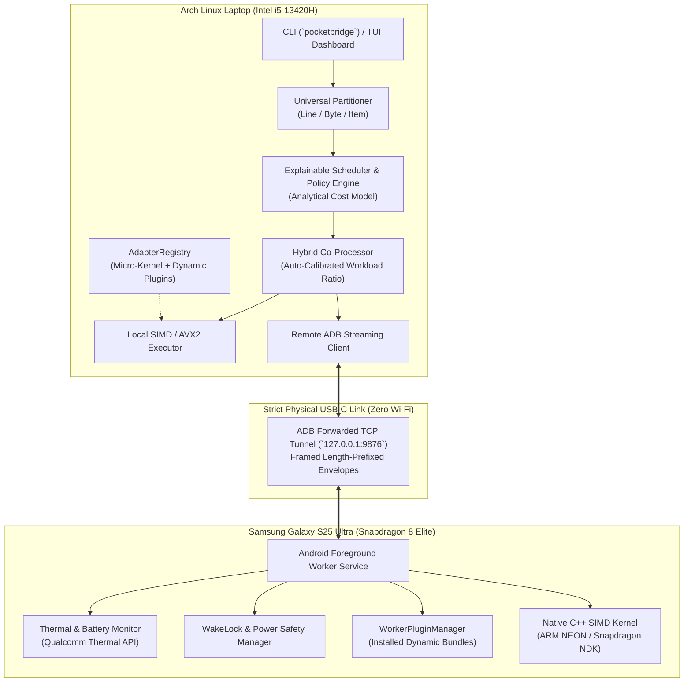

# PocketBridge ⚡

**Wired USB-to-USB Compute Offloading & Co-Processing Engine**  
*Seamlessly distribute heavy workloads between your Linux laptop and Android phone over a physical USB-C cable.*

[](https://github.com/vijaygovindBiju/PocketBridge/actions/workflows/ci.yml)
[](https://opensource.org/licenses/MIT)
[](https://github.com/vijaygovindBiju/PocketBridge/releases)
[](https://github.com/vijaygovindBiju/pocketbridge-plugins)

---

## 🎯 Overview

Modern flagship smartphones (like the **Snapdragon 8 Elite** with custom Oryon cores) possess immense compute power and memory bandwidth that often sit idle while connected to a laptop.

**PocketBridge** turns your connected phone into an active co-processor over a secure, physical **USB-to-USB** link (`127.0.0.1` via ADB tunnel). Rather than making unrealistic claims about transparent RAM pooling, PocketBridge moves bounded, partitionable workloads across the link and empirically benchmarks real-world throughput and speedup gains.

### Key Capabilities

- **Micro-Kernel Core:** Ships with a lean SIMD calibration benchmark (`chunk_transform.v1`). Users can test their USB link and hardware IPC ratio instantly with **zero downloads**.
- **Dynamic Hybrid Co-Processing:** Automatically benchmarks your laptop CPU and phone SoC (e.g. Snapdragon 8 Elite vs. Intel Core i5), auto-calibrating workload partition ratios (e.g., 50.7% Phone / 49.3% Laptop) for maximum combined throughput.
- **Universal Process Proxy (`pocketbridge exec`):** Partition and stream *any* Unix command's data (line-by-line, byte chunking, or item lists) concurrently between laptop and phone.
- **Fault-Tolerant Multi-Device Fleet (`pocketbridge fleet`):** Connect multiple Android devices; distribute work chunks with dynamic work-stealing and automatic failover on cable unplug.
- **Hardware Safety & Thermal Gates:** Respects Android WakeLocks, battery charging state, and Qualcomm thermal throttling levels (`normal`, `light`, `moderate`, `severe`).
- **Modular Plugin & AI Model Hub (`pocketbridge plugin`):** Heavy workloads (image batch processing, data analytics, Whisper speech-to-text, headless Chromium tabs, FFmpeg transcoding) are installed on-demand from the official [pocketbridge-plugins](https://github.com/vijaygovindBiju/pocketbridge-plugins) community registry without bloating the core binary.

---

## 🏛️ System Architecture



---

## 📦 Tested Hardware Baseline

PocketBridge is validated and benchmarked on real physical hardware:

| Role | Device | Processor / Specs | OS / Runtime |
|------|--------|-------------------|--------------|
| **Host** | Laptop | 13th Gen Intel Core i5-13420H (12 threads, 4.6 GHz) | Arch Linux (Kernel 6.13) |
| **Worker** | Samsung Galaxy S25 Ultra (`SM-S938B`) | Qualcomm Snapdragon 8 Elite (8 Oryon cores @ 4.32 GHz) | Android 15 (API 35) |
| **Link** | Physical USB-C 3.2 Gen 1 | Latency: **~0.18 ms** · Throughput: **> 125 MB/s** | `127.0.0.1:9876` via ADB |

---

## 🚀 Quick Start

### 1. Prerequisites

- **Host:** Linux (Arch, Ubuntu, Fedora) with `adb` and `cargo` installed.
- **Phone:** Android device with **USB Debugging enabled** connected via USB cable.

### 2. Launch the Phone Worker

```bash
# Build & install the Android worker APK
cd worker-android
./gradlew assembleRelease
adb install -r app/build/outputs/apk/release/app-release-unsigned.apk # or install pre-built APK

# Forward port 9876 over USB-C
adb forward tcp:9876 tcp:9876
```

Open the **PocketBridge Worker** app on your phone and tap **"Start Worker Service"**.

### 3. Build & Run the Host CLI

```bash
cd host
cargo build --release
```

#### Test Link Instantly (Zero-Download Verification)
```bash
# Handshake and check hardware profiles
cargo run --release -- profile

# Run baseline SIMD hardware calibration benchmark
cargo run --release -- bench --runs 20

# Run compute workload (hybrid co-processing)
cargo run --release -- run -a chunk_transform --records 100000 --hybrid
```

#### Interactive Terminal Dashboard (TUI)
```bash
cargo run --release -- tui
```
*Switch tabs with `[1]` (Dashboard), `[2]` (Benchmark), `[3]` (Hardware Profile). Press `[c]` to connect, `[j]` to run jobs, `[q]` to quit.*

---

## 💻 CLI Command Reference

### `pocketbridge run` — Compute Workload Execution
Execute compute tasks locally, remotely, or concurrently partitioned across both devices:
```bash
# Hybrid co-processing with auto-calibrated partition ratio
pocketbridge run -a chunk_transform --records 500000 --hybrid

# Manual ratio: 60% Laptop, 40% Phone
pocketbridge run -a chunk_transform --records 500000 --hybrid --host-ratio 0.60

# Force phone worker execution only
pocketbridge run -a chunk_transform --records 100000 --remote-only

# Force local host execution only
pocketbridge run -a chunk_transform --records 100000 --local-only
```

### `pocketbridge exec` — Universal Process Partitioning (Phase 7)
Slice and stream any command's input concurrently between laptop and phone:
```bash
# Split CSV transformation line-by-line across laptop and phone
pocketbridge exec -s line -i dataset.csv -- tr '[:lower:]' '[:upper:]'

# Split byte-chunked stream across devices
pocketbridge exec -s byte -i large_blob.bin -- sha256sum
```

### `pocketbridge fleet` — Multi-Device Fleet Coordinator (Phase 6)
Coordinate workloads across multiple connected phones with automatic work-stealing and failover:
```bash
# Distribute 1,000,000 items across 16 chunks to all connected workers
pocketbridge fleet -a chunk_transform --records 1000000 --chunks 16
```

### `pocketbridge plugin` — Modular Plugin & AI Model Hub (Phase 10)
Manage on-demand workloads from the [pocketbridge-plugins](https://github.com/vijaygovindBiju/pocketbridge-plugins) registry:
```bash
# List built-in engines, installed plugins, and available catalog
pocketbridge plugin list

# Inspect plugin requirements and specifications
pocketbridge plugin info image-batch
pocketbridge plugin info ai-whisper

# Install a plugin (runs hardware pre-flight checks, verifies SHA-256, syncs to phone over USB)
pocketbridge plugin install image-batch
pocketbridge plugin install data-analytics

# Execute newly installed plugin
pocketbridge run -a image_batch --records 1000 --hybrid

# Remove an installed plugin
pocketbridge plugin remove image-batch
```

### `pocketbridge bench` & `profile`
```bash
# Run USB link latency & throughput benchmark suite
pocketbridge bench --runs 25

# Inspect host and phone CPU, RAM, GPU, and thermal hardware profiles
pocketbridge profile
```

---

## 🧩 Community Plugin Hub

Community plugins are hosted in a separate public repository to protect core engine integrity:

👉 **[pocketbridge-plugins Repository](https://github.com/vijaygovindBiju/pocketbridge-plugins)**

| Plugin | Version | Size | Type | Description |
|--------|---------|------|------|-------------|
| **image-batch** | v1.0.0 | 1.2 MB | Native | Parallel image resizing, inversion, and box-blur filtering |
| **data-analytics** | v1.0.0 | 0.8 MB | Native | Structured CSV/TSV table reduction, sum, min/max, filtering |
| **ai-whisper** | v1.1.0 | 71.5 MB | AI Model | On-device speech-to-text audio transcription on Snapdragon NPU |
| **browser-cdp** | v0.9.0 | 14.3 MB | Web Headless | Offloads inactive browser tabs to Android WebView |
| **media-ffmpeg** | v1.2.0 | 33.4 MB | Native | Parallel H.264/AV1 video transcoding slices across devices |

Community developers can submit new plugins by opening a Pull Request against `pocketbridge-plugins` without touching core PocketBridge code!

---

## 🛡️ Security & Privacy

- **Strictly Local Link:** PocketBridge communicates exclusively over physical USB-C via `127.0.0.1`. No open network ports or Wi-Fi sockets are exposed.
- **Cryptographic Verification:** All downloaded plugins must pass SHA-256 hash checks before execution.
- **Hardware Safety:** Automatic thermal throttling protects mobile device longevity.
- **No Arbitrary Shell Injections:** Worker service enforces strict schema parameters.

---

## 🧪 Automated Test Suite

All 37 unit and integration tests across the workspace pass cleanly:

```bash
cd host
cargo test --workspace
```

```text
test result: ok. 37 passed; 0 failed; 0 ignored; 0 measured; 0 filtered out
```

---

## 📄 License

This project is licensed under the MIT License — see the [LICENSE](LICENSE) file for details.  
Community plugin registry infrastructure is licensed under Apache-2.0.

---

**Author:** [Vijaygovind Biju](https://github.com/vijaygovindBiju)
