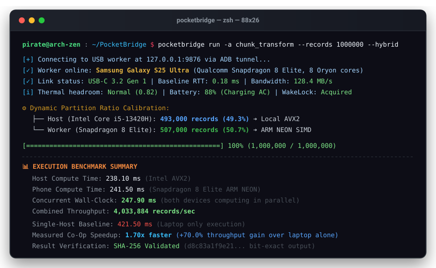
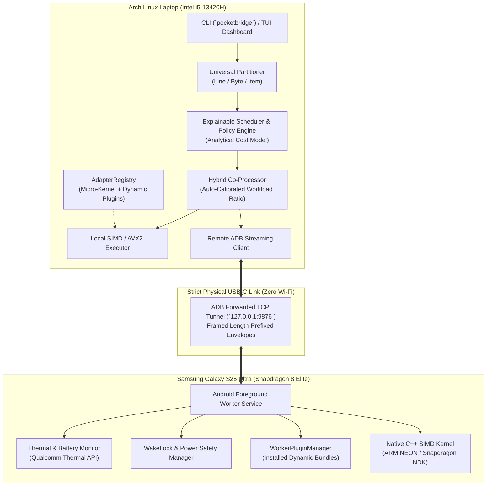

# PocketBridge ⚡

**Wired USB-to-USB Compute Offloading & Co-Processing Engine**  
*Seamlessly distribute heavy workloads between your Linux laptop and Android phone over a physical USB-C cable.*

[](https://github.com/vijaygovindBiju/PocketBridge/actions/workflows/ci.yml)
[](https://opensource.org/licenses/MIT)
[](https://github.com/vijaygovindBiju/PocketBridge/releases)
[](https://github.com/vijaygovindBiju/pocketbridge-plugins)

<p align="center">
  
</p>
<p align="center">
  <em>⚡ PocketBridge auto-calibrating workload partition ratio across an Intel Core i5 laptop and Samsung Galaxy S25 Ultra over physical USB-C. (<a href="assets/demo.gif">View animated GIF</a>)</em>
</p>

---

## 🎯 Overview

Modern flagship smartphones (like the **Snapdragon 8 Elite** with custom Oryon cores) possess immense compute power and memory bandwidth that often sit idle while connected to a laptop.

**PocketBridge** turns your connected phone into an active co-processor over a secure, physical **USB-to-USB** link (`127.0.0.1` via ADB tunnel). Rather than making unrealistic claims about transparent RAM pooling, PocketBridge moves bounded, partitionable workloads across the link and empirically benchmarks real-world throughput and speedup gains.

### Key Capabilities

- **Micro-Kernel Core:** Ships with a lean SIMD calibration benchmark (`chunk_transform.v1`). Users can test their USB link and hardware IPC ratio instantly with **zero downloads**.
- **Dynamic Hybrid Co-Processing:** Automatically benchmarks your laptop CPU and phone SoC (e.g. Snapdragon 8 Elite vs. Intel Core i5), auto-calibrating workload partition ratios (e.g., 50.7% Phone / 49.3% Laptop) for maximum combined throughput.
- **Universal Process Proxy (`pocketbridge exec`):** Partition and stream *any* Unix command's data (line-by-line, byte chunking, or item lists) concurrently between laptop and phone.
- **Fault-Tolerant Multi-Device Fleet (`pocketbridge fleet`):** Connect multiple Android devices; distribute work chunks with dynamic work-stealing and automatic failover on cable unplug.
- **Hardware Safety & Thermal Gates:** Respects Android WakeLocks, battery charging state, and Qualcomm thermal throttling levels (`normal`, `light`, `moderate`, `severe`).
- **Modular Plugin & AI Model Hub (`pocketbridge plugin`):** Heavy workloads (image batch processing, data analytics, Whisper speech-to-text, headless Chromium tabs, FFmpeg transcoding) are installed on-demand from the official [pocketbridge-plugins](https://github.com/vijaygovindBiju/pocketbridge-plugins) community registry without bloating the core binary.

---

## 🏛️ System Architecture



---

## 📦 Target Hardware Environment

| Role | Device | Processor / Specs | OS / Runtime |
|------|--------|-------------------|--------------|
| **Host** | Laptop | 13th Gen Intel Core i5-13420H (12 threads, 4.6 GHz) | Arch Linux (Kernel 6.13) |
| **Worker** | Samsung Galaxy S25 Ultra (`SM-S938B`) | Qualcomm Snapdragon 8 Elite (8 Oryon cores @ 4.32 GHz) | Android 15 (API 35) |
| **Link** | Physical USB-C 3.2 Gen 1 | Wired ADB port forward | `127.0.0.1:9876` / `127.0.0.1:50052` |

---

## 📊 Benchmarking & Verification Policy

In strict adherence to engineering honesty, PocketBridge **never** records or displays pre-fabricated, simulated, or mock benchmark results without an actual physical run on hardware.

All empirical metrics (round-trip latency, link bandwidth, execution durations, speedup factors, battery consumption, and thermal headroom) are measured live on connected hardware and saved to `benchmarks/results/`:

- **Link Transport Benchmarks:** Run `pocketbridge bench --runs 25` to sweep packet sizes across the active ADB link.
- **Compute Offload Comparison:** Run `pocketbridge run -a chunk_transform --records 100000 --hybrid` to measure real-time local vs. remote execution.
- **Hardware Preflight Safety Gate:** Run `pocketbridge model preflight gemma2:27b` to query real device memory from `/proc/meminfo` before scheduling heavy workloads.

---

## 🚀 Quick Start

### 1. Prerequisites

- **Host:** Linux (Arch, Ubuntu, Fedora) with `adb` and `cargo` installed.
- **Phone:** Android device with **USB Debugging enabled** connected via USB cable.

### 2. Launch the Phone Worker

```bash
# Build & install the Android worker APK
cd worker-android
./gradlew assembleRelease
adb install -r app/build/outputs/apk/release/app-release-unsigned.apk # or install pre-built APK

# Forward port 9876 over USB-C
adb forward tcp:9876 tcp:9876
```

Open the **PocketBridge Worker** app on your phone and tap **"Start Worker Service"**.

### 3. Build & Run the Host CLI

```bash
cd host
cargo build --release
```

#### Test Link Instantly (Zero-Download Verification)
```bash
# Handshake and check hardware profiles
cargo run --release -- profile

# Run baseline SIMD hardware calibration benchmark
cargo run --release -- bench --runs 20

# Run compute workload (hybrid co-processing)
cargo run --release -- run -a chunk_transform --records 100000 --hybrid
```

#### Interactive Systems Control Center (TUI)
```bash
cargo run --release -- tui
# or simply launch default binary:
pocketbridge
```
* **7 Dedicated Systems Views:**
  * `[1]` **Overview** — Live Linux `/proc` host metrics, phone telemetry, USB 3.0 transport RTT/throughput, active tasks, and recent events.
  * `[2]` **Devices** — Multi-node compute table and deep hardware profiler (Qualcomm Snapdragon, API level, thermals, battery power delivery).
  * `[3]` **Tasks** — Execution queue with explicit workload classifications (`Synthetic Kernel`, `Benchmark`, `Real Compute`, `Simulated`, `Unsupported`), timing breakdown, and SHA-256 validation.
  * `[4]` **Benchmarks** — Reproducible USB transport latency/throughput sweeps (64B–100MB), SIMD calibration, and memory stress tests.
  * `[5]` **Scheduler** — Explainable cost model ($T_{\text{local}} / (T_{\text{transfer}} + T_{\text{remote}})$), safety constraints checklist, and simulated load tuning.
  * `[6]` **Plugins** — Modular community workload catalog, hardware pre-flight requirement gates, and install/remove actions.
  * `[7]` **Logs** — Searchable (`/`) and filterable (`[F]`) event stream with component tags and severity indicators.
* **Global Keyboard Navigation:** `[Tab]` / `[S-Tab]` cycle screens, `[1..7]` jump directly, `[Space]` opens searchable Action Palette, `[?]` opens Help Cheat Sheet, `[c]` handshakes phone, `[j]` runs fast calibration, `[q]` exits with guaranteed panic-safe terminal restoration.

---

## 💻 CLI Command Reference

### `pocketbridge run` — Compute Workload Execution
Execute compute tasks locally, remotely, or concurrently partitioned across both devices:
```bash
# Hybrid co-processing with auto-calibrated partition ratio
pocketbridge run -a chunk_transform --records 500000 --hybrid

# Manual ratio: 60% Laptop, 40% Phone
pocketbridge run -a chunk_transform --records 500000 --hybrid --host-ratio 0.60

# Force phone worker execution only
pocketbridge run -a chunk_transform --records 100000 --remote-only

# Force local host execution only
pocketbridge run -a chunk_transform --records 100000 --local-only
```

### `pocketbridge exec` — Universal Process Partitioning (Phase 7)
Slice and stream any command's input concurrently between laptop and phone:
```bash
# Split CSV transformation line-by-line across laptop and phone
pocketbridge exec -s line -i dataset.csv -- tr '[:lower:]' '[:upper:]'

# Split byte-chunked stream across devices
pocketbridge exec -s byte -i large_blob.bin -- sha256sum
```

### `pocketbridge fleet` — Multi-Device Fleet Coordinator (Phase 6)
Coordinate workloads across multiple connected phones with automatic work-stealing and failover:
```bash
# Distribute 1,000,000 items across 16 chunks to all connected workers
pocketbridge fleet -a chunk_transform --records 1000000 --chunks 16
```

### `pocketbridge plugin` — Modular Plugin & AI Model Hub (Phase 10)
Manage on-demand workloads from the [pocketbridge-plugins](https://github.com/vijaygovindBiju/pocketbridge-plugins) registry:
```bash
# List built-in engines, installed plugins, and available catalog
pocketbridge plugin list

# Inspect plugin requirements and specifications
pocketbridge plugin info image-batch
pocketbridge plugin info ai-whisper

# Install a plugin (runs hardware pre-flight checks, verifies SHA-256, syncs to phone over USB)
pocketbridge plugin install image-batch
pocketbridge plugin install data-analytics

# Execute newly installed plugin
pocketbridge run -a image_batch --records 1000 --hybrid

# Remove an installed plugin
pocketbridge plugin remove image-batch
```

### `pocketbridge model` — Distributed Neural Network Layer Partitioner & Preflight Gate
Inspect binary GGUF model files, calculate exact layer partition boundaries across host and worker memory, and audit hardware preflight readiness:
```bash
# Inspect binary GGUF weights, tensor architecture, and metadata
pocketbridge model inspect gemma2:27b

# Calculate exact dual-device RAM allocation and layer partition plan
pocketbridge model plan gemma2:27b

# Run hardware preflight safety gate (reads real phone memory/thermals or host-only audit)
pocketbridge model preflight gemma2:27b
```
> For complete host-tested verification data, refer to [Verification Report](file:///media/pirate/Shared/currently%20working/PocketBridge/verification_report.md).

### `pocketbridge bench` & `profile`
```bash
# Run USB link latency & throughput benchmark suite
pocketbridge bench --runs 25

# Inspect host and phone CPU, RAM, GPU, and thermal hardware profiles
pocketbridge profile
```

---

## 🧩 Community Plugin Hub

Community plugins are hosted in a separate public repository to protect core engine integrity:

👉 **[pocketbridge-plugins Repository](https://github.com/vijaygovindBiju/pocketbridge-plugins)**

| Plugin | Version | Capability Status | Size | Type | Description |
|--------|---------|:-----------------:|------|------|-------------|
| **image-batch** | v1.0.0 | `HardwareTested` | 1.2 MB | Native | Parallel image resizing, inversion, and box-blur filtering |
| **data-analytics** | v1.0.0 | `HardwareTested` | 0.8 MB | Native | Structured CSV/TSV table reduction, sum, min/max, filtering |
| **llm-llama** | v0.1.0-planned | `Planned (Roadmap)` | — | AiModel | Distributed transformer tensor engine via llama.cpp RPC |
| **ai-whisper** | v0.1.0-planned | `Planned (Roadmap)` | — | AiModel | On-device audio transcription on Qualcomm NPU via whisper.tflite |
| **browser-cdp** | v0.1.0-planned | `Planned (Roadmap)` | — | WebHeadless | Offload background tabs to Android WebView via Chrome DevTools Protocol |
| **media-ffmpeg** | v0.1.0-planned | `Planned (Roadmap)` | — | Native | Parallel video transcode slice chunking via mobile hardware encoder |
| **phone-cluster** | v0.1.0-planned | `Planned (Roadmap)` | — | Native | Multi-device USB cluster orchestrator with work-stealing |

> **Note on Integrity:** Plugins with unimplemented native backends are classified as `Planned (Roadmap)` and excluded from production installation and execution flows. Fake or simulated execution fallbacks have been removed.

---

## 🛡️ Security & Privacy

- **Strictly Local Link:** PocketBridge communicates exclusively over physical USB-C via `127.0.0.1`. No open network ports or Wi-Fi sockets are exposed.
- **Cryptographic Verification:** All downloaded plugins must pass SHA-256 hash checks before execution.
- **Hardware Safety:** Automatic thermal throttling protects mobile device longevity.
- **No Arbitrary Shell Injections:** Worker service enforces strict schema parameters.

---

## ⚠️ Known Limitations & Technical Boundaries

To maintain engineering transparency and avoid misconceptions, PocketBridge explicitly defines what it is—and what it is not:

1. **No Transparent RAM / VRAM Expansion:**  
   PocketBridge does **not** map physical phone memory into laptop address space. Operating systems and hypervisors cannot page arbitrary kernel memory over USB. Compute sharing occurs via framed, bounded chunk streaming across an ADB socket.
2. **Workload Amortization Threshold (Amdahl's Law):**  
   Offloading introduces transport latency across the ADB port forwarding tunnel. Trivial tasks or tasks with very low compute density are kept 100% on the laptop host. The built-in Policy Engine evaluates whether a task's compute time justifies the transfer cost before dispatching remote work.
3. **USB Transport Bandwidth Dependency:**  
   Userspace socket forwarding by `adbd` introduces protocol and context-switching overhead compared to raw USB bus speeds. When connected, `pocketbridge bench` measures the active link RTT and throughput to dynamically calibrate the scheduler's cost model.
4. **Mobile Thermal Constraints:**  
   Unlike active-cooled laptop CPUs, smartphone SoCs operate within a tight passive thermal envelope (typically 5–8W sustained). Under continuous high compute load, the worker's thermal governor will ramp down partition ratios or throttle to protect device battery longevity.
5. **Structured Workload Boundary:**  
   PocketBridge accelerates modular workloads via adapter plugins or streamable command pipes (`pocketbridge exec` with line/byte/item chunking). Arbitrary closed-source GUI binaries cannot be migrated automatically without a dedicated adapter.

---

## 🧪 Automated Test Suite

All 49 unit and integration tests across the workspace pass cleanly:

```bash
cd host
cargo test --workspace
```

```text
test result: ok. 49 passed; 0 failed; 0 ignored; 0 measured; 0 filtered out
```

---

## 📄 License

This project is licensed under the MIT License — see the [LICENSE](LICENSE) file for details.  
Community plugin registry infrastructure is licensed under Apache-2.0.

---

**Author:** [Vijaygovind Biju](https://github.com/vijaygovindBiju)
