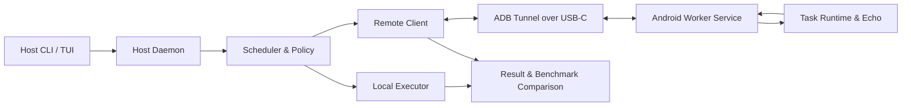

# PocketBridge

**PocketBridge enables compute offloading from a Linux laptop to an attached Android phone.**  
**Features a Rust host with a terminal UI paired with a native Kotlin Android worker.**  
**Communicates securely over a high-speed ADB link via USB-C on localhost.**  
**Benchmarks latency and throughput to measure real-world performance gains.**

[](https://github.com/vijaygovindBiju/PocketBridge/actions/workflows/ci.yml)
[](https://opensource.org/licenses/MIT)

---

## 🎯 Overview

PocketBridge explores whether an attached Android phone can contribute spare compute capacity to an Arch Linux laptop. Rather than making unrealistic claims about transparent physical RAM pooling or GPU virtualization, PocketBridge moves bounded, explicitly supported jobs across a high-speed, local link (ADB over USB-C) and empirically benchmarks whether offloading was actually faster.



- **Host (Laptop):** Rust daemon with an interactive TUI (`ratatui`) & CLI to schedule jobs, profile hardware, and benchmark the link.
- **Worker (Phone):** Native Kotlin Android app with a foreground service running a streaming TCP daemon on `127.0.0.1:9876`.
- **Link:** ADB-forwarded TCP over USB-C — localhost-only, fast, and secure.

---

## 🏗️ Project Structure

```text
PocketBridge/
├── host/                    # Rust Cargo workspace
│   ├── pocketbridge-core/   # Protocol, framing, profiler, and benchmark runner
│   └── pocketbridge-host/   # Ratatui TUI dashboard & CLI binary
├── worker-android/          # Android Kotlin app (Compose UI + Foreground Service)
├── docs/                    # Architecture, Protocol, Decisions, Experiments
├── benchmarks/results/      # Benchmark JSON reports
└── .github/workflows/       # Automated CI (Rust tests + Android build)
```

---

## 🚀 Quickstart

### 1. Build and Run the Host (Linux)

```bash
# Launch the interactive Terminal UI
cd host
cargo run --release

# Or use CLI subcommands
cargo run --release -- profile   # Inspect host & phone hardware
cargo run --release -- connect   # Handshake with worker
cargo run --release -- bench     # Run link latency & throughput benchmarks
```

#### TUI Keybindings
- `[1]` / `[2]` / `[3]` or `[Tab]` — Switch between Dashboard, Benchmark, and Profile tabs
- `[c]` — Connect / Handshake with phone worker
- `[d]` — Disconnect
- `[r]` — Refresh device hardware profiles
- `[Enter]` — Start benchmark suite (in Benchmark tab)
- `[+/-]` — Adjust benchmark repetitions
- `[s]` — Save benchmark report to JSON
- `[q]` — Quit

### 2. Build and Install the Android Worker

```bash
cd worker-android
./gradlew assembleDebug

# Install on connected phone
adb install -r app/build/outputs/apk/debug/app-debug.apk
```

Open the **PocketBridge Worker** app on your phone and tap **"Start Worker Service"**.

---

## 📚 Documentation

Detailed specifications and engineering decisions are available in [`docs/`](docs/):

- [Project Specification](docs/PROJECT.md) — Vision, scope, and non-goals
- [Architecture](docs/ARCHITECTURE.md) — Host, worker, and communication design
- [Wire Protocol](docs/PROTOCOL.md) — Length-prefixed framing and message envelopes
- [Roadmap](docs/ROADMAP.md) — 7 milestones from feasibility to native app
- [Architecture Decisions (ADRs)](docs/DECISIONS.md) — Design records and rationales
- [Experiments & Benchmarks](docs/EXPERIMENTS.md) — Latency and throughput methodology
- [Security Policy](SECURITY.md) — Threat model, sandboxing, and reporting

---

## 🧪 Testing

Run all unit and integration tests (including the mock worker TCP test):

```bash
cd host
cargo test --workspace
```

---

## 📄 License

This project is licensed under the MIT License — see the [LICENSE](LICENSE) file for details.
