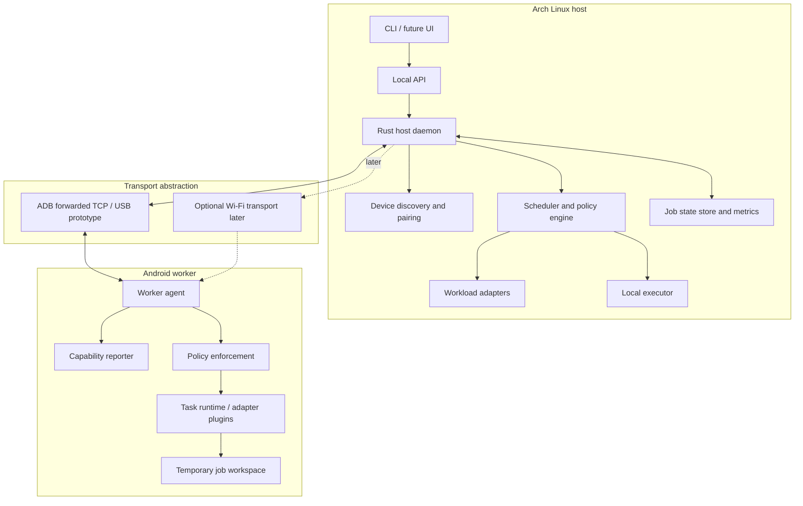
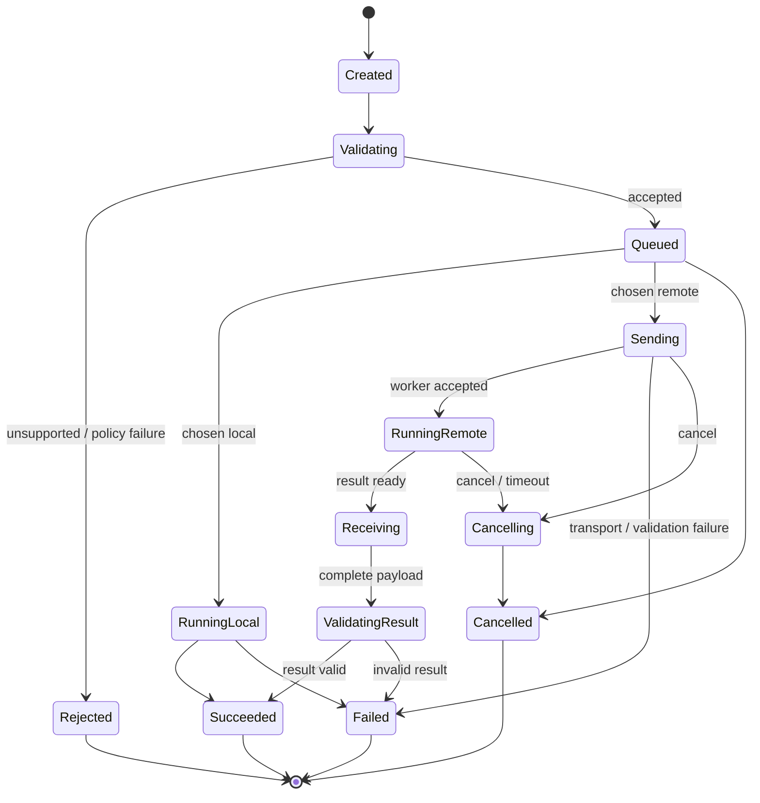

# Architecture

## 1. Design overview

PocketBridge uses a Linux host as coordinator and an Android phone as an optional worker. The host maintains policy and job state. The worker advertises capabilities and executes only the job types/runtime actions that it explicitly supports.

## 2. Host components

### Host daemon

Responsibilities:
- Own the worker connection and pairing state.
- Accept local job requests.
- Enforce policy and user permissions.
- Maintain durable job state and audit logs.
- Coordinate local and remote execution.
- Handle retries, cancellation, timeouts, and disconnects.

Suggested language: Rust. This matches the intended Linux systems focus and offers good control over concurrency, binaries, and process lifecycle. The Android agent may use Kotlin for platform lifecycle integration, with native code only where justified.

### Scheduler and policy engine

The scheduler should first be rule-based and explainable. It should consider:
- Workload adapter says the job is offloadable.
- Input/output volume and estimated transfer cost.
- Job granularity and parallelism.
- Host and worker CPU/memory pressure.
- Worker available memory budget and recent thermal status.
- Battery/charging state and user settings.
- Architecture/runtime compatibility.
- Deadline, priority, and whether the job is idempotent.
- Historical local and remote measurements for similar jobs.

Example decision (conceptual only):

`remote_total_estimate = queue_estimate + transfer_estimate + startup_estimate + execution_estimate + result_transfer_estimate`

Offload only if the job is compatible and the estimated remote cost is better than local cost by a configurable safety margin. Early versions should use measured historical values and never assume performance from nominal CPU core count alone.

### Workload adapter

Each adapter implements a narrow contract:
- Can this workload be offloaded?
- What data must be sent?
- What executable/runtime is needed?
- What resource limits are required?
- How are progress, cancellation, and output represented?
- Is retry safe?
- How is output correctness validated?

An adapter is the boundary between a user application and the distributed system. Without an adapter or a compatible distributed runtime, PocketBridge cannot safely move arbitrary code or a running process.

### Local executor

The local executor runs the same supported job interface on the laptop. This is essential for correctness comparisons and fallback. It also gives the scheduler a baseline for deciding whether offloading is worthwhile.

## 3. Android worker components

### Worker agent

- Starts only after the user opts in, using the supported Android execution model.
- Authenticates the host and exposes a narrow protocol endpoint.
- Advertises current capabilities and availability.
- Accepts bounded jobs, emits progress, and returns results.
- Rejects incompatible jobs and enforces resource/time limits.
- Cleans temporary files on job completion, cancellation, or expiry.

### Early implementation options

**Option A — Termux prototype:** Best for validating a command-line worker quickly. Termux provides a Linux-like terminal environment and packages for tools such as Python, Clang, and other runtimes. It is not equivalent to a full general-purpose Linux machine and remains subject to Android lifecycle and resource constraints.

**Option B — Native Android app/service:** Better control over lifecycle, user-visible permissions, device metadata, and a future UI. More work because packaging, background execution, native toolchains, and process isolation need proper Android integration.

The project can start with Option A to test the workload protocol, but should not let prototype assumptions harden into production architecture.

## 4. Transport layer

### First experiment: ADB over USB

ADB supports forwarding TCP connections between a host and an Android device. This is a useful way to prototype a request/response protocol without requiring the phone to expose a normal IP network interface to the laptop. It requires developer options/USB debugging and explicit host authorization.

The implementation must measure the actual link throughput and latency on the specific device/cable/OS versions. Do not assume all USB-C cables support USB 3.x or that ADB forwarding gives raw USB throughput.

### Transport interface

The rest of the system should depend on a transport interface, not on ADB-specific code. The interface needs:
- connect / disconnect;
- authenticated session establishment;
- message read/write;
- streaming of large payloads;
- backpressure and flow control;
- timeout and cancellation;
- clean termination and reconnect support.

Possible later transports include local Wi-Fi, USB networking where supported, or another explicitly tested direct-link transport.

## 5. Job lifecycle

States should be persisted before externally meaningful transitions. A dropped connection must not silently convert a running job to success. The host should distinguish “worker may still be running” from “worker is definitely stopped” when cancellation acknowledgement is unavailable.

## 6. Resource semantics

### CPU

The phone can run a separate task using its own ARM64 CPU. It cannot add its cores to an arbitrary x86-64 process automatically. The work must be portable or compiled for the worker's ABI, and data must cross the transport.

### RAM

Do not implement a fake “RAM pool” in MVP. Remote memory access means copying or accessing pages over a link; latency is much higher than local DRAM. A game cannot ordinarily use remote memory as if it were local process memory. Potential later experiments include remote caches, application-managed object stores, checkpointed state, and carefully measured remote-memory schemes, but these are not transparent RAM expansion.

### GPU / NPU

An Android GPU or NPU may be usable by a workload that explicitly supports the device's Android APIs and runtime. It does not automatically appear as a Vulkan/CUDA/OpenGL device to the Linux host or become a replacement for the laptop's graphics GPU. Gaming acceleration is a research track, not an initial deliverable.

### Disk / cache

Phone storage can hold task artifacts or cached data, subject to user-approved quotas. It should not be advertised as laptop RAM or a low-latency substitute for local storage.

## 7. Scheduler policy: proposed stages

1. **Static eligibility:** adapter, runtime, ABI, permissions, resource limits, and data policy.
2. **Cost estimation:** size and transfer estimates, startup/queue overhead, historical execution timing.
3. **Safety checks:** temperature, battery, memory budget, user pause, deadline, network health.
4. **Decision:** local / remote / reject / defer, with a human-readable reason.
5. **Feedback:** update estimates using measured timings, but avoid overreacting to a single noisy sample.

Machine learning is unnecessary for initial scheduling. Begin with deterministic rules and measurement; introduce prediction only if the baseline is reliable.

## 8. Failure handling

- Disconnect before acceptance: job remains eligible for local execution.
- Disconnect during input transfer: discard incomplete transfer and retry only if safe.
- Disconnect during execution: mark worker state unknown until reconciled; don't blindly duplicate non-idempotent work.
- Worker out of memory: return a typed error; host may retry locally if policy allows.
- Thermal throttling: reduce or pause jobs according to policy.
- Invalid or truncated output: fail validation and preserve diagnostics.
- Host crash: recover persisted job state and reconcile with worker on reconnect.
