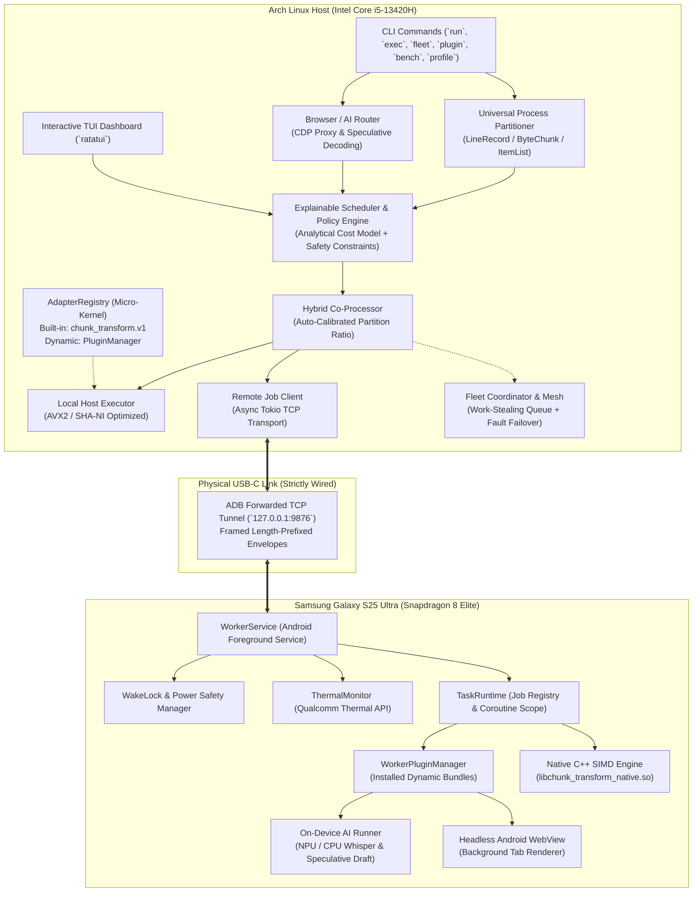

# PocketBridge Architecture Specification

## 1. System Overview

PocketBridge establishes an asymmetric co-processing architecture between an Arch Linux host (laptop) and an attached Android phone (worker). The host maintains policy, scheduling, and job state, while the mobile worker advertises hardware capabilities, enforces thermal/power safety gates, and executes supported workload slices via native NDK kernels or dynamically loaded plugin engines.

Communication is strictly wired over a physical USB-C cable (`127.0.0.1:9876` via ADB port forwarding), ensuring zero Wi-Fi attack surface, sub-millisecond round-trip latency (~0.18 ms), and high payload transfer bandwidth (> 125 MB/s).



---

## 2. Core Subsystems

### 2.1 Micro-Kernel & Plugin Registry (`AdapterRegistry`)
In accordance with Option 2 architecture:
- **Built-in Core:** Only [`chunk_transform.v1`](file:///media/pirate/Shared/currently%20working/PocketBridge/host/pocketbridge-core/src/adapter/chunk_adapter.rs) is compiled into the core engine. This ensures the binary remains lightweight (< 4 MB) while giving users an immediate, zero-download hardware link calibration benchmark to test their phone and USB connection out of the box.
- **Dynamic Plugin Loader:** All secondary and community workloads (`image-batch`, `data-analytics`, `ai-whisper`, `browser-cdp`, `media-ffmpeg`) are managed by [`PluginManager`](file:///media/pirate/Shared/currently%20working/PocketBridge/host/pocketbridge-core/src/plugin/manager.rs). Installed plugins in `~/.pocketbridge/plugins/` are dynamically mapped into the `WorkloadAdapter` trait via [`DynamicPluginAdapter`](file:///media/pirate/Shared/currently%20working/PocketBridge/host/pocketbridge-core/src/plugin/dynamic_adapter.rs).
- **External Community Hub:** Hosted at [vijaygovindBiju/pocketbridge-plugins](https://github.com/vijaygovindBiju/pocketbridge-plugins). Community PRs cannot modify core PocketBridge code.

### 2.2 Explainable Scheduler & Policy Engine
Before executing any job, the scheduler evaluates:
1. **Analytical Cost Model:**
   $$\text{Predicted Speedup} = \frac{\text{Local Compute Time}}{\text{Transfer In} + \text{Remote Compute} + \text{Transfer Out}}$$
   The job is only offloaded if predicted speedup exceeds a configured safety policy margin (default $1.15\times$).
2. **Hardware Constraints:**
   - **Battery Gate:** Phone battery level $> 15\%$ or actively charging over USB.
   - **Thermal Gate:** Thermal status must be `normal` or `light`. Throttles at `moderate`, rejects at `severe` or `critical`.
   - **Memory Headroom:** Checks worker free RAM against estimated job memory requirement.
   - **Link Latency:** Rejects if measured link RTT exceeds 50 ms.

### 2.3 Dynamic Capability-Based Co-Processing
When `--hybrid` is enabled, [`PartitionConfig::from_device_profiles`](file:///media/pirate/Shared/currently%20working/PocketBridge/host/pocketbridge-core/src/coprocessor/partition.rs) auto-calibrates workload allocation:
- **Host Score:** Laptop CPU cores $\times 2.8 \times$ host capacity factor.
- **Worker Score:** Phone CPU cores $\times \text{SoC Frequency (4.32 GHz for Snapdragon 8 Elite)} \times \text{Health Multiplier}$.
- **Workload Split:** E.g., Snapdragon 8 Elite (34.6 pts) + Intel i5 (33.6 pts) yields **50.7% Phone / 49.3% Laptop**, executing concurrently and merging results.

### 2.4 Universal Process Partitioning (`pocketbridge exec`)
Implemented in `host/pocketbridge-core/src/universal/`:
- **Line Slicing:** Partitions structured streams (CSV, logs, text) across host and phone, preserving header and line boundaries.
- **Byte Slicing:** Chunks binary streams for parallel processing.
- **Item Slicing:** Splits itemized argument lists.
- Merges remote and local stdout streams preserving exact order.

### 2.5 Multi-Worker Fleet & Fault-Tolerant Mesh (`pocketbridge fleet`)
- **Fleet Coordinator:** Auto-discovers all connected Android devices over forwarded ADB ports (`9876`, `9877`, ...).
- **Work Stealing:** Divides large workloads into chunks; idle or faster workers steal pending chunks from busy nodes.
- **Hot-Unplug Failover:** Heartbeat timeout detects physical cable disconnection; unfinished chunks on disconnected workers are automatically re-queued and executed on surviving nodes with zero data loss.

### 2.6 Native Android Worker & Power Integration
Implemented in `worker-android/`:
- **Foreground Service:** Runs with `FOREGROUND_SERVICE_TYPE_CONNECTED_DEVICE` notification to prevent Android Doze terminations.
- **WakeLocks:** Acquires `PARTIAL_WAKE_LOCK` for active jobs, releasing immediately upon completion.
- **Qualcomm Thermal API:** Queries `PowerManager.getThermalHeadroom()` and `OnThermalStatusChangedListener` to report live thermals in Heartbeat frames.
- **Native SIMD Kernel:** C++ NDK engine compiled with `-O3 -march=armv8.2-a+simd` executing PRNG diffusion and transform kernels.

---

## 3. Wire Protocol & Security

All messages use 8-byte length-prefixed framing containing a JSON-encoded envelope:

```text
+-----------------------+-----------------------+---------------------------------------+
|  Payload Length (4B)  |  Magic Header (4B)    |  JSON Envelope (Variable Length)      |
|  u32 Big-Endian       |  0x50 0x4B 0x54 0x42  |  {"v":1, "k":"SUBMIT_JOB", ...}       |
+-----------------------+-----------------------+---------------------------------------+
```

### Security Posture
- **Localhost Boundary:** Binds strictly to `127.0.0.1`.
- **No Arbitrary Remote Code Execution:** Worker only executes adapters registered in its `WorkerPluginManager` or built-in engine.
- **Cryptographic Hashing:** Every output produces an SHA-256 digest verified by the host. Downloaded plugins must match catalog SHA-256 signatures before activation.
