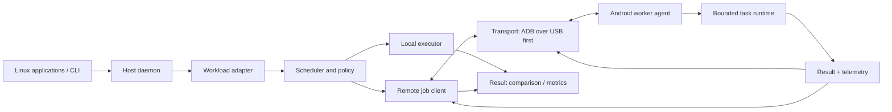

# PocketBridge

**Working name:** PocketBridge  
**Status:** Concept / feasibility prototype  
**Document version:** 0.1.0  
**Target host:** Arch Linux laptop (initially x86-64)  
**Target worker:** Android phone (initially Samsung Galaxy S25 Ultra / ARM64)  
**Preferred link:** USB-C, with Wi-Fi as a fallback for experiments

> PocketBridge explores whether an attached Android phone can contribute useful computing capacity to a Linux laptop. The long-term vision is opportunistic, low-friction resource offloading. The first implementation will run explicitly supported remote jobs; it will not claim to pool physical RAM or transparently accelerate arbitrary applications or games.

## Why

A laptop may run short of CPU capacity, memory, or GPU resources while a connected phone has unused capacity. PocketBridge aims to make that spare capacity useful by identifying work that can safely be moved to the phone, executing it there, and returning results to the laptop.

The difficult part is not connecting the devices. It is finding work that can be moved across two different operating systems and CPU architectures without making the result slower, unsafe, or incorrect.

## Reality check

PocketBridge must distinguish two goals:

1. **Practical first goal — task offloading:** Move supported, self-contained jobs to a phone worker. Examples include independent data-processing jobs, batches of image transformations, selected scripts, and compatible build tasks.
2. **Long-term research goal — transparent acceleration:** Make existing applications benefit with little or no application changes. This is substantially harder. A normal Android phone cannot simply become extra physical RAM or CPU/GPU cores in an unmodified Linux game. It would require application/runtime integration, special drivers or kernel work, or a workload with a suitable distributed execution model.

A USB-C cable provides a physical connection; it does not automatically expose phone CPU cores, GPU devices, or RAM to Linux. The transport and actual workload must be measured.

## Proposed first release

The first milestone should prove a narrow end-to-end path:

- The Linux host detects a paired Android worker over USB debugging / ADB.
- The user explicitly enables the worker and sees its reported capabilities.
- A Rust host service submits a supported job to an Android-side worker.
- The worker executes it in an isolated, bounded process and returns the result.
- The host records timings and compares remote execution with local execution.
- The scheduler declines offloading when transfer overhead, device load, temperature, battery, or memory pressure makes it a bad choice.

This proves the control plane and scheduling loop without pretending that arbitrary workloads can already be migrated.

## Current scope

### In scope

- Arch Linux host service, initially written in Rust.
- Android worker using Termux for an early prototype or a native Android service for a later release.
- USB-first communication, investigating ADB port forwarding as the initial transport.
- A transport abstraction so USB/ADB, Wi-Fi, and other links can be evaluated independently.
- Explicit task API, worker capability advertisement, resource telemetry, scheduling, cancellation, deadlines, result validation, and benchmarks.
- Security controls: pairing, authenticated requests, bounded execution, no public listener by default, and user consent.

### Out of scope for MVP

- Combining host and phone RAM into one transparent physical address space.
- Making any unmodified game automatically borrow phone CPU/GPU/RAM.
- Presenting the phone GPU as a native Linux GPU device without a specialized supported backend.
- Rooting the phone, unlocking its bootloader, or installing a custom kernel as a prerequisite.
- Running arbitrary untrusted executables sent by another device.
- Promising that a phone will improve performance in every workload.

## Architecture at a glance



The host owns the policy and application-facing API. The phone is a worker, not a second set of Linux CPU cores. A job is remote only if its adapter can define the inputs, execution requirements, outputs, cancellation rules, and failure behavior.

## Suggested repository layout

```text
pocketbridge/
├── README.md
├── docs/
│   ├── PROJECT_SPEC.md
│   ├── ARCHITECTURE.md
│   ├── PROTOCOL.md
│   ├── ROADMAP.md
│   ├── SECURITY.md
│   ├── TEST_PLAN.md
│   ├── RESEARCH_AND_PRIOR_ART.md
│   └── DECISIONS.md
├── host/                  # Rust daemon, scheduler, local executor
├── worker-android/         # Android agent; Termux prototype may come first
├── adapters/               # Supported workload integrations
├── benchmarks/             # Reproducible local-vs-remote tests
└── examples/               # Small, deterministic demo jobs
```

## Principles

1. **Measure before claiming speedup.** Report local time, remote time, data-transfer time, and energy/thermal effects where measurable.
2. **Fail safe.** If the phone disconnects, overheats, runs low on battery, or cannot meet a deadline, the host falls back or reports a clear failure.
3. **Explicit support beats magic.** A workload is eligible only when an adapter can describe how it is executed remotely.
4. **Keep the host usable.** The scheduler must not send all work away simply because a phone is attached.
5. **Privacy by default.** Do not send arbitrary files or process memory to the phone without a user-visible policy.
6. **No unsupported hardware promises.** Remote memory is not equivalent to local RAM, and remote GPU execution is not a generic replacement for local graphics hardware.

## Documentation

- [Project specification](docs/PROJECT_SPEC.md)
- [Architecture](docs/ARCHITECTURE.md)
- [Wire protocol](docs/PROTOCOL.md)
- [Roadmap](docs/ROADMAP.md)
- [Security and privacy](docs/SECURITY.md)
- [Validation plan](docs/TEST_PLAN.md)
- [Related work and feasibility](docs/RESEARCH_AND_PRIOR_ART.md)
- [Architecture decisions](docs/DECISIONS.md)

## Research starting points

- [Android Debug Bridge (ADB) documentation](https://developer.android.com/tools/adb)
- [Termux](https://termux.dev/en/)
- [distcc — distributed C/C++ compilation](https://github.com/distcc/distcc)
- [llama.cpp RPC backend](https://github.com/ggml-org/llama.cpp/tree/master/tools/rpc)
- [Hermit remote-memory research implementation](https://github.com/uclasystem/hermit)
- [Linux kernel zram documentation](https://www.kernel.org/doc/html/latest/admin-guide/blockdev/zram.html)

Related work shows that *specific* distributed tasks and remote-memory designs are possible. It does not establish that arbitrary laptop processes can transparently use an Android phone as extra CPU, RAM, or GPU.

## Status and honest success criteria

The project is successful at MVP if it demonstrates a supported job type that works correctly on both devices, securely recovers from disconnects, and reports whether offloading was faster or slower. A result of “this workload is not worth offloading” is a valid engineering result.

No performance numbers are claimed yet. All speedup claims must come from repeatable benchmarks on the target laptop, phone, cable, Android version, and workload.
